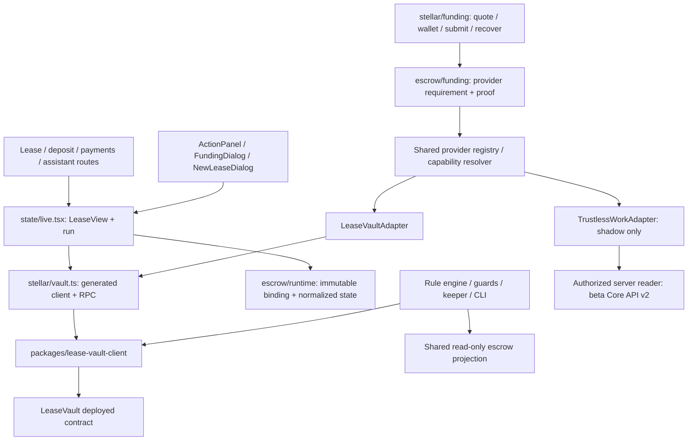

# Hybrid escrow migration: audit and shadow integration

Audit date: 2026-10-25. Scope: the connected `front/` application, `agents/`, contracts, generated bindings, deployment configuration and the existing USDC funding engine. The separate `frontend/` prototype is not the connected application and is unchanged.

**Delivery status:** provider abstraction, LeaseVault compatibility, immutable selection, shared funding orchestration, recovery, server persistence adapters and read-only Trustless Work scaffolding are implemented. **Trustless Work financial operations remain disabled.** This is step A of the migration, not a claim of live Trustless Work funding. No contract was modified, deployed or funded during this work.

## Verified architecture and priorities

| Finding | Classification | Consequence / implemented response |
|---|---|---|
| React 18, Vite 5.4, TypeScript 5.6, Tailwind; connected routes under `/app` | VERIFIED from `front/` | Preserve routes, action dialogs and purple design. |
| LeaseVault Soroban v3 source and generated `lease-vault-client` using Stellar SDK 16.4 | VERIFIED from source/package lock | Wrap existing reads and guards; preserve signatures and bindings. |
| Deployed configuration is Stellar Testnet | VERIFIED by configuration and read-only RPC audit | No Mainnet funding or automatic network switching. |
| `fund(id, tenant, accept_yield)` takes first rent + deposit + accepted buffer, not deposit alone | VERIFIED from contract | Provider determines funding requirement; swap engine no longer assumes all providers take the same total. |
| Supported-asset funding already uses direct USDC or classic strict-receive path payment to the tenant's own wallet, then a separate Soroban call | VERIFIED from source/tests | Keep separate transactions and persisted envelopes; no atomicity promise. |
| Optional sign-in is client-side demo UI; wallets are Testnet keypairs in localStorage | VERIFIED | Not server authentication or a production wallet. New provider endpoint fails closed without trusted sessions. |
| No application database / trusted participant authorization was wired | MISSING | Add SQLite binding/attempt stores and an injected authorization boundary; do not pretend these are deployed. |
| Assistant in the connected app is deterministic, not an LLM | VERIFIED | Add read-only common escrow context; never describe an answer as a signed transaction. |
| Legacy agent chain tools and keeper can sign contract operations | VERIFIED | Preserve them, explicitly separate from the new read-only assistant projection. Keeper still enumerates LeaseVault only. |
| Fiável-approved TW deployment, exact asset, role assignments, ABI/code identity and independent verification | MISSING | No create/fund/release XDR is guessed. TW adapter stays `rolloutReady=false`. |
| Authenticated TW funding, dispute and net settlement on Testnet | UNVERIFIED | Mandatory gate before any rollout beyond shadow reads. |

Three highest-priority fixes: prevent provider replacement or double funding; separate provider-specific required amounts from conversion; reject the exact-net rental settlement on Trustless Work until fees and rights can satisfy it. These gates are implemented before enabling new financial calls.

## LeaseVault dependency map

Direct and indirect coupling inventory (source, not generated dependencies):

| Area | Files / dependence | Migration treatment |
|---|---|---|
| Contract / ABI | `contracts/lease_vault/src/*`, `packages/lease-vault-client/*` | Authoritative rental state machine; untouched. |
| Deployment | `deployments/testnet.json`, `scripts/deploy-testnet.sh`, generated deployment/binding setup | Existing addresses unchanged; no deployment. |
| Network and wallet | `front/src/stellar/{config,wallets,vault}.ts` | Configured token/issuer, role keys, reads and signed calls remain LeaseVault-specific. |
| Funding | `front/src/stellar/funding/{domain,engine,storage,stellar}.ts` | Generic engine accepts provider requirements; actual SDK port remains verified LeaseVault port. Old storage scope keys preserved byte-for-byte. |
| Live data | `front/src/state/live.tsx` | Existing LeaseVault enumeration and raw snapshots retained; add normalized `escrow` field and provider guard before legacy writes. |
| Actions / presentation | `components/live/{ActionPanel,NewLeaseDialog,FundingDialog,lease-view,cards,invest,reputation,agent}`, `pages/live/{LeasePages,MoneyPages,AssistantPage}` | Raw lease, rent, yield and action views still use rental-specific data. Technical details / assistant explanations use shared state. No claim of full provider-neutral rental routing yet. |
| Rules and agents | `agents/src/{rules,guards,explain,chain,tools,coordinator,cli,demo}.ts` | Rules consume LeaseVault snapshots; chain/keeper retains legacy authority. New `escrow-context.ts` has no signing/submission ability. |
| New migration boundary | `front/src/escrow/{runtime,leasevault,funding}.ts`, `packages/escrow-domain/src/*` | Explicit adapter boundary; unsupported rights stay visible. |
| Tests | Existing rule, SDK, quote and engine tests plus new `front/src/escrow/*test*` and `agents/test/escrow-context.test.ts` | Synthetic fixtures are not deployment evidence. |

## Trustless Work evidence and version boundaries

Official documentation and live OpenAPI were read, rather than inferring capabilities from marketing:

* [V2 REST introduction](https://docs.trustlesswork.com/trustless-work/v2-en/api-rest/introduction): beta Core API at `https://beta.api.trustlesswork.com`; API key (`x-api-key`, `id.secret`) or wallet-session authentication. V1 `dev.api.trustlesswork.com` / `api.trustlesswork.com` are a separate compatibility line.
* [V2 SDK setup](https://docs.trustlesswork.com/trustless-work/v2-en/escrow-js-sdk/getting-started.md): framework-neutral `@trustless-work/escrow-js`. Registry metadata observed `1.0.0-beta.1`; the older React package `@trustless-work/escrow` was `3.0.5`. Neither is silently installed or treated as a verified Fiável deployment.
* Actual beta [single-release OpenAPI](https://beta.api.trustlesswork.com/api/single-release/v2-json) and [query OpenAPI](https://beta.api.trustlesswork.com/api/escrows-query-json): OpenAPI 3.0.0, `info.version=1.0`; this metadata is not a deployed contract ABI version.
* [Initialization](https://docs.trustlesswork.com/trustless-work/v2-en/api-rest/deploy/initialize-escrow.md) and [schema](https://docs.trustlesswork.com/trustless-work/v2-en/introduction/developer-resources/schema): single/multi-release, plural approval/release/resolution roles, receiver/platform/admin. These roles are not automatically tenant/landlord equivalents.
* [Funding](https://docs.trustlesswork.com/trustless-work/v2-en/api-rest/deploy/fund-escrow.md): API prepares unsigned XDR; wallet authorization and submission are separate. A returned prepared hash is not a confirmation.
* [On-chain escrow getter](https://docs.trustlesswork.com/trustless-work/v2-en/api-rest/escrow-information/get-escrow.md): GET reads contract state, whereas indexer/query views may lag. An API response is still not an independent Fiável RPC proof.

Observed beta paths include `/escrow/single-release/v2/{contractId}`, `/deploy`, `/fund`, `/approve-milestones`, `/release-funds`, `/dispute`, `/resolve-dispute`, `/withdraw-remaining-funds` and `/stellar/send-transaction`. Only the documented **GET** transport is implemented here. An unauthenticated read-only probe returned HTTP 401 / `AUTH_CREDENTIAL_MISSING`; no financial POST was performed.

Docs use decimal strings in amount conventions while parts of live OpenAPI use JSON numbers. The normalizer accepts exact strings and safe integer numbers; fractional JSON numbers are rejected rather than silently rounded. A representative deployed response and authoritative precision rules remain a rollout requirement.

## Compatibility matrix

`VERIFIED` below means verified in Fiável source, unless explicitly labeled network. `Documented` TW behavior is not a passed integration test.

| Feature | LeaseVault | Trustless Work V2 | Required adapter / compatibility | Evidence |
|---|---|---|---|---|
| Initialize | Landlord creates rental terms | Documented single/multi-release deployment | Rental adapter preserved; TW factory, identity and roles UNVERIFIED | `lib.rs:create_lease`; TW initialization/schema |
| USDC funding | Whole rent + deposit + optional buffer | Documented amount-based fund XDR | Different totals; TW accepted token UNVERIFIED | `lib.rs:fund`; TW fund docs |
| Funded state | Fresh lease read + confirmed matching transaction | Getter / balance available | API provenance alone cannot set verified badge; TW RPC proof MISSING | `vault.ts:fundingProofFor`; TW getter |
| Depositor / beneficiary | Tenant signs and receives refunds; landlord receives rent/awards | Funder / receiver and service providers | No inferred tenant=receiver or guarantor refund rights | Contract; TW schema |
| Approval / resolver roles | Fixed parties + arbiter, contract windows | Role arrays / approval gates; dispute-resolver restrictions | Human roles must be deliberately assigned and checked | Contract; TW schema/dispute docs |
| Milestones | Rental schedule, no generic milestones | Documented single/multi-release | Documented capability, not enabled for Fiável rentals | TW schema |
| Full deposit refund | Conditional no-keys / no-claim release after rent settlement | Distribution / remaining-balance paths | Net refund, initiator rights and fees UNVERIFIED; no unconditional promise | Contract; TW dispute docs |
| Full beneficiary release | No generic landlord withdrawal | Approved release with fees | Incompatible with an unrestricted rental withdrawal | Contract; TW lifecycle |
| Partial tenant refund | Undisputed funds refunded on opening claim | Native distribution recipients | Gross allocation documented; exact net fails fee requirement | Contract; TW resolving disputes |
| Partial landlord payout | Arbiter bounded by disputed amount | Native distribution recipients | Keep LeaseVault for exact-net mandatory scenario | Same |
| Dispute creation / resolution | Evidence hash, bond, response and arbitration windows | Documented role-authorized dispute/resolution | No automatic mapping of rental deadlines/bond/expired claims | Contract; TW dispute lifecycle |
| Cancellation | Specific `refund_no_keys`, not arbitrary cancellation | General rental cancellation not verified | UNVERIFIED / disabled | Contract; no approved mapping |
| Events / history | RPC events + saved transaction references | Query/indexed views and contract reads | TW complete lifecycle/event reconciliation MISSING | `vault.ts:contractEvents`; TW query API |
| Multiple / partial funding | No; one complete `fund` call | Funding amount parameter documented | TW overfunding/duplicate/partial behavior UNVERIFIED | Contract; TW fund docs |
| Transaction verification | Horizon/RPC + exact SDK operation checks | Unsigned XDR + separate submission/status | TW independent contract/asset/amount proof MISSING | Existing funding SDK tests; TW API |
| API auth / signatures | Existing browser Testnet signer | Key/session for API, wallet for financial auth | Server-only key and trusted participant lookup required | TW REST intro; server handler |
| Unpaid rent / Blend / silence deadlines | Enforced by current rental contract | No verified equivalents | Unsupported rentals select LeaseVault before funding | Contract / capability resolver |

### Mandatory 1,800 / 150 / 1,650 scenario

[Official dispute lifecycle](https://docs.trustlesswork.com/trustless-work/v2-en/introduction/technology-overview/escrow-lifecycle/dispute-resolution.md) and [resolution payload](https://docs.trustlesswork.com/trustless-work/v2-en/api-rest/deploy/resolving-disputes.md) describe distributions and a **0.30% protocol fee plus any platform fee**, allocated proportionally. With 1,800 USDC and zero platform fee, the protocol fee is 5.40; gross 150 / 1,650 yields approximately **149.55 / 1,645.05 net**, subject to the deployed rounding rules. Native distributions exist, but they do not demonstrate the requested exact net outcome. Milestones do not establish a fee exemption.

Therefore this lease selects **LeaseVault**, not two escrow backends and not an invented top-up. In LeaseVault, assuming no unpaid rent/yield adjustment, opening a 150 claim returns the undisputed 1,650 immediately; the human arbiter later authorizes up to 150 of the remaining claim for the landlord. The separate claim bond is not counted as deposit principal. Tests reject allocating the already-refunded 1,650 a second time. Changing the timing to hold all 1,800 until arbitration would be a separate contract change; this migration does not imply that behavior.

## Implemented domain and rollout

`packages/escrow-domain/src/` defines `EscrowProvider`, `LeaseVaultAdapter` (frontend SDK boundary), `TrustlessWorkAdapter`, registry, capability resolver, normalizer and read-only assistant projection. The interface prepares human-reviewed plans; it has no signer or autonomous submit method.

A binding persists internal lease ID, provider, provider escrow ID, contract, network, exact asset/issuer, expected deposit, required total, verified funding amount, status, capabilities, transaction references and recovery status. Amounts are integer token units (7 decimals). Unknown historical funding totals stay `null`; they are not reconstructed from today's remaining guarantee.

* `ESCROW_PROVIDER_MODE=leasevault` (default): new escrows require verified LeaseVault capabilities.
* `hybrid`: prefer TW only when deployment readiness AND every required capability are verified; current rental requirements fall back to LeaseVault.
* `trustless_work`: refuse new unsupported rentals. This flag cannot bypass `rolloutReady=false`.
* Existing bindings are resolved before consulting rollout flags. They never switch, unlock or lose their transaction references because a flag changes. No automatic movement of existing deposits exists.

In Vite this nonsecret flag is read from the repository-root environment and compiled into the bundle; rebuild/restart after changing it. `TW_API_KEY` is **server-only** and never exported through `VITE_*`. An actual TW lease-creation UI is deliberately disabled pending verification; changing a feature flag is not a deployment approval.

### Persistence and HTTP boundary

The existing demo uses localStorage for provider records and signed payment attempts. Persistence failure blocks signing; old funding keys retain their original format. Browser records are not an authorization system and do not replace fresh chain verification. Clearing browser storage can lose local recovery references; retain wallet/explorer records. A production host must adopt the durable store before enabling TW writes.

`schema.sql` and `server/sqlite-store.mjs` provide actual tested SQLite constraints: one provider per lease, immutable identity, locked funding amount, no deletion/rebinding, scoped idempotency keys and transaction envelopes/references. They are **not automatically connected to a deployed application database**. Tests exercise in-memory constraints and closing/reopening an actual file. See [store setup](../packages/escrow-domain/README.md).

`front/api/escrow.ts` installs the read-only shadow handler. Default response is **503**, because no trusted server session/database exists in this application. A host must inject `authenticate`, `loadAuthorizedBinding` and the server-only reader. A user-provided contract ID is never used instead of authorized binding lookup. Unauthorized reads, financial HTTP writes, provider errors, timeouts and redirects fail closed. The local rate limiter is per process; distributed deployments need a shared limiter.

### Shared funding and recovery

The quote engine remains upstream of the selected provider. Requirements and proof checks are provider ports; no protocol selection is hidden inside conversion. Real currently connected port: LeaseVault only. Generic TW-style 1,800-unit requirements are tested using synthetic ports, not presented as live TW execution.

The existing stages are retained: `reviewed → swap-pending → swap-confirmed → fund-pending → funded`, with `swap-failed` / `fund-failed` and binding recovery `pending|required|none`. UI quote/loading/signature states are transient; signed envelopes and transaction hashes are persisted before submission. Completion requires confirmed transaction, matching contract state and independent matching proof.

If swap succeeds and funding fails/rejects: retain the confirmed swap, source/maximum, exact USDC receive amount, recipient wallet and all hashes; show recoverable wallet balance or explicitly unavailable balance. Retry only funding. Pending status rebroadcasts the same unexpired envelope, never a fresh swap. Web Locks / in-process guards prevent concurrent UI submissions; database idempotency is available for a future authenticated host. Contract rules remain the final authority against duplicate deposits.

Supported live paths remain direct configured USDC, or a real executable Stellar classic strict-receive route to that USDC followed by separately authorized LeaseVault funding. No external-chain assets, bridge, Soroban router or atomic swap-and-fund was verified.

## Network evidence

The existing deployment uses Testnet, LeaseVault `CCSWLUOQ6ZXKF5BQOSUPTNGJODWMRVPFEVKGNWNVRGG2U2LNGQJSEJAZ`, token SAC `CAQCFVLOBK5GIULPNZRGATJJMIZL5BSP7X5YJVMGCPTUEPFM4AVSRCJU`, and classic `USDC:GATALTGTWIOT6BUDBCZM3Q4OQ4BO2COLOAZ7IYSKPLC2PMSOPPGF5V56`. This is the configured Blend Testnet asset, not a claim about Circle Mainnet USDC.

Read-only `npm run audit:funding` verified network passphrase/protocol, issuer-to-SAC mapping and LeaseVault `get_config` token. It found **zero XLM conversion routes** for 1,800 or 2,700 of this asset. The UI must report unavailable conversion; no static substitute rate is supplied. A TW escrow must separately prove it accepts exactly this asset or explicitly configure a verified alternative before selection. No TW contract ID is configured here.

## Test results and requested coverage

Executed in this workspace:

| Check | Result |
|---|---|
| `front: npm test` | 100 passed: original quote/engine/SDK tests plus 29 hybrid/domain/UI tests and 12 SQLite/server/HTTP tests. |
| `front: npm --ignore-scripts run build` | Passed TypeScript + Vite production build; existing large-chunk advisory remains. |
| `agents: npm test` | 20 passed, including provider-neutral read permissions. |
| `agents: npm run typecheck` | Passed. |
| Server `.mjs` syntax / browser bundle secret-reference checks | Passed; server key/reader implementation absent from client output. |
| `front: npm run audit:funding` | Read-only live network checks passed; no observed XLM route. |

Tests use Node 22's experimental built-in SQLite. No new lint tool is introduced; the app has no lint script. No Rust source changed, so no contract build/deploy is represented as performed.

| Requested cases | Evidence / limits |
|---|---|
| 1, 3, 22: existing LV, fallback, no silent migration | Registry / capability / database tests, all modes and immutable identity. |
| 2: compatible new TW lease | Synthetic verified provider selection test only. Actual TW readiness remains false. |
| 4–11: direct USDC, XLM path, no route, expiry, slippage, issuer/contract, network, balances | Existing quote/engine/SDK tests plus generic provider requirement and proof mismatch tests. Network liquidity separately probed. |
| 12–15: rejection, swap-success/fund-failure, retry without swap, duplicates | Existing engine/SDK tests plus common-provider recovery and SQL idempotency tests. No real wallet signature made. |
| 16: funding verification | Matching proof required; cached/API amounts never create verified badge. |
| 17–20: refund, 150/1,650, unauthorized release, dispute under review | Adapter guards, fee arithmetic, already-refunded allocation rejection. No TW settlement performed. |
| 21: provider unavailable | Server reader/HTTP tests; no financial fallback or credential leakage. |
| 23: frontend correct state | Server-rendered details distinguish API/cache from RPC proof; existing UI retained. Browser/mobile interaction not verified in this environment. |
| 24: AI financial authority | Assistant participant projection, no signer, human-only plans; legacy keeper authority is separate and unchanged. |

## Changed areas and remaining gates

Added shared domain/server/schema files, frontend adapters/orchestrator/tests, escrow technical details, server shadow endpoint, and read-only agent context. Updated funding ports/engine, state, creation eligibility, recovery UI, assistant explanations, Vite/TS aliases and environment examples. Contract source, deployment addresses, routing, existing authentication behavior and blockchain bindings are preserved.

Before enabling any TW financial path:

1. Establish trusted backend sessions, participant access checks and a deployed durable store; wire the currently disabled endpoint with these dependencies.
2. Approve a Testnet TW factory/deployment and ABI/code identity; validate token/issuer/network, exact XDR operations, plural roles, fee rules and refund/release rights.
3. Implement provider-specific unsigned funding and independent RPC verification only against those approved interfaces. Test pending/rejected/duplicate/recovery states with real signed transactions and real liquidity.
4. Run actual TW funding, release and dispute tests. Explicitly resolve the exact-net fee incompatibility without silently reducing tenant or landlord proceeds; otherwise retain LeaseVault for these leases.
5. Complete provider-neutral lease enumeration and rental-specific UI mapping only for workflows TW can enforce. Keep monitoring every original provider even if new-lease eligibility is rolled back.
6. Verify responsive/mobile wallet interaction and browser recovery. Replace browser demo keys with a production wallet before real-value use.

These are blockers to live TW rollout, not completed integrations. Existing funds are never moved as part of this change.
